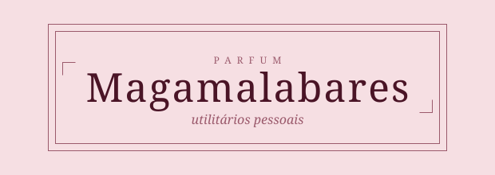

<picture>
  <source media="(prefers-color-scheme: dark)" srcset="assets/banner-noite.svg">
  
</picture>

Repositório pessoal de utilitários: calculadoras, scripts e pequenas ferramentas do dia a dia. Cada utilidade é um frasco da coleção, com número próprio e o mesmo rótulo.

## Coleção

| Nº | Utilidade | |
|---|---|---|
| 1 | Quanto eu ganho vendendo? Shopee (CPF) e Nuvemshop, regras de nov/2026 | [abrir](vendas/) |
| 2 | Qual embalagem eu cadastro? Peso e medidas do pacote a partir do produto | [abrir](vendas/embalagem.html) |

## Estrutura

```
index.html              ← vitrine com todas as utilidades
assets/
  magamalabares.css     ← cores, fontes e componentes
  magamalabares.js      ← botão noite/dia
  banner-noite.svg
  banner-dia.svg
modelo/index.html       ← copie para criar uma utilidade nova
vendas/
  index.html            ← Nº 1 · arquivo único, funciona sem internet
  test.js               ← testes das taxas: node vendas/test.js
  embalagem.html        ← Nº 2 · estimador de embalagem, arquivo único
  test-embalagem.js     ← testes da embalagem: node vendas/test-embalagem.js
```

## Utilidade nova

1. Copie `modelo/` para uma pasta com nome curto em minúsculas.
2. Use o próximo número livre (Nº 2, Nº 3…).
3. Título como pergunta ou ação; subtítulo com contexto e data das regras.
4. Bloco NOTA para limitações; regras e fonte em texto pequeno no fim.
5. Confira nos dois modos (botão noite/dia).
6. Adicione a linha na tabela acima e um card na vitrine (`index.html`).
